<div align="center">

# Acme — multi-tenant SaaS analytics platform

A production-grade SaaS dashboard: authentication, organizations, role-based access control, Stripe subscriptions, a product-analytics ingestion API and an audit log — built with **Next.js 16, TypeScript, PostgreSQL and Prisma** on a clean, tested architecture.

**[Live demo](https://saa-s-platform-lac.vercel.app)** · [Architecture](docs/ARCHITECTURE.md) · [Security model](docs/SECURITY.md) · [Technical decisions](docs/DECISIONS.md)


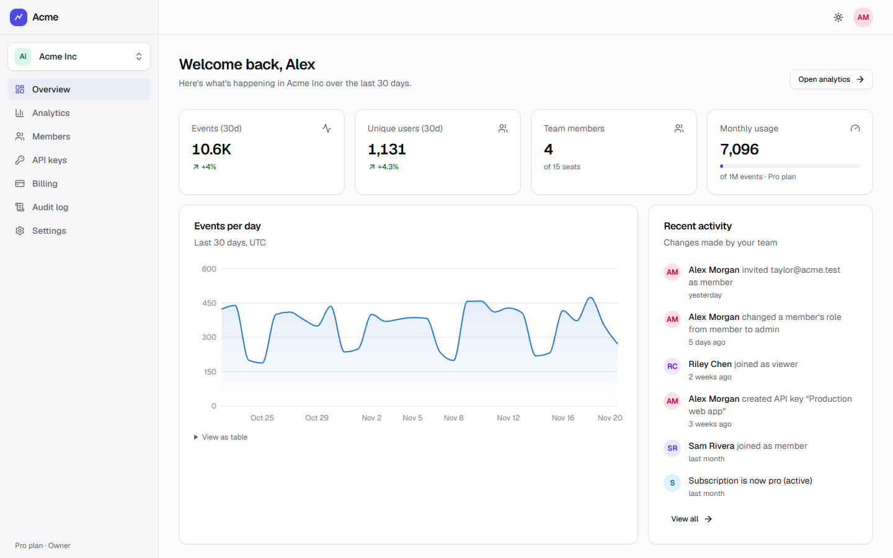

</div>

## Try it

Open the **[live demo](https://saa-s-platform-lac.vercel.app)** and click **Explore the live demo** — no sign-up needed. You land in a seeded Pro workspace with six months of events. It's read-only and resets nightly; sign up to get your own organization and try every write path.

To see role-based access from the other side, sign in as a different demo member (password `demo-password-123`):

| Account | Role | What changes |
| --- | --- | --- |
| `demo@acme.test` | Owner | Everything, including billing and deleting the org |
| `jordan@acme.test` | Admin | Manages members below Admin, API keys, settings; can't touch billing or owners |
| `sam@acme.test` | Member | Analytics and API keys, read-only |
| `riley@acme.test` | Viewer | Analytics only — billing, keys and audit log are refused even by direct URL |

## Highlights

- **Multi-tenancy done properly.** Users belong to many organizations with a different role in each. Every query is tenant-scoped; non-members get a 404, and another tenant's IDs behave as if they don't exist.
- **One authorization policy, tested exhaustively.** A single permission matrix is enforced inside every use case, and a test runs **every protected operation as every role** (72 cases) and fails if any outcome drifts from the matrix.
- **Real billing.** Stripe Checkout, Customer Portal and trials; plan limits on seats, events, API keys and history; idempotent, order-tolerant webhooks.
- **A working product.** `POST /api/v1/events` with hashed API keys, per-key rate limits and monthly quotas, feeding dashboards with period-over-period comparisons and a live event explorer.
- **Clean architecture.** Domain → application → infrastructure → presentation, with the dependency rule enforced by ESLint and business logic tested without a database.
- **Production concerns covered.** Env validation, security headers, audit trail, health check, structured logs, Docker image, migrations in the deploy pipeline.

## Screenshots

| | |
| :-: | :-: |
| 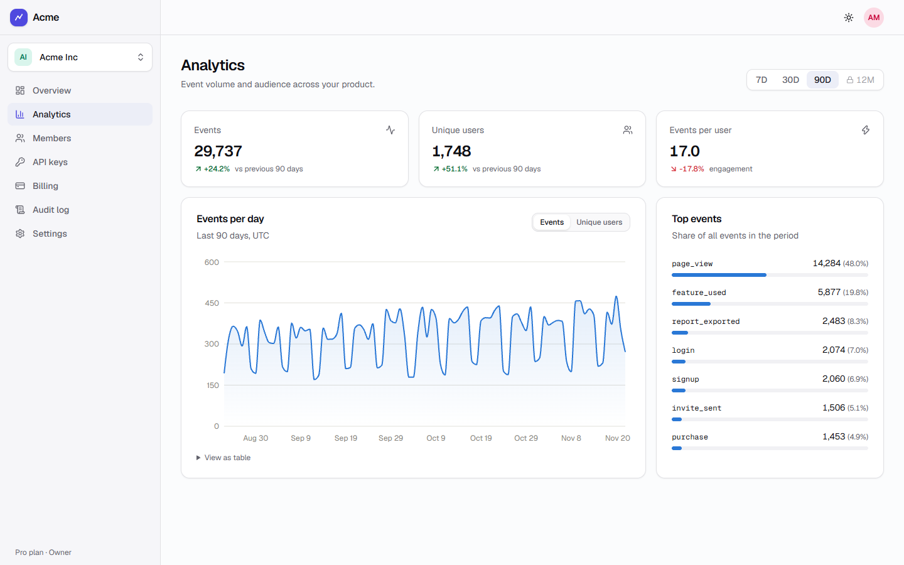<br>**Analytics** — 7/30/90-day and 12-month ranges, gated by plan | 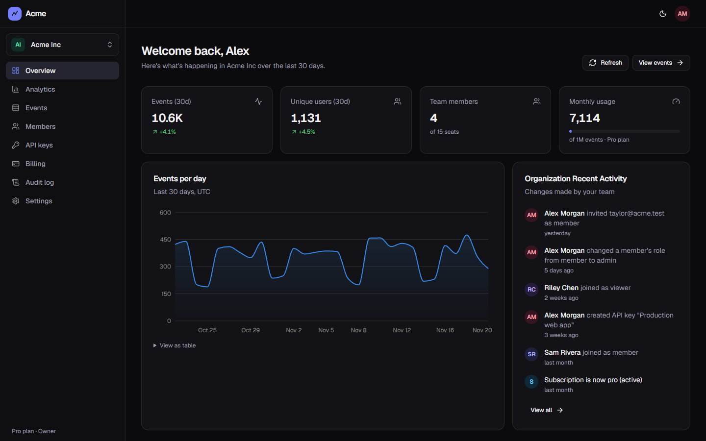<br>**Dark mode** — tokens tuned per theme |
| 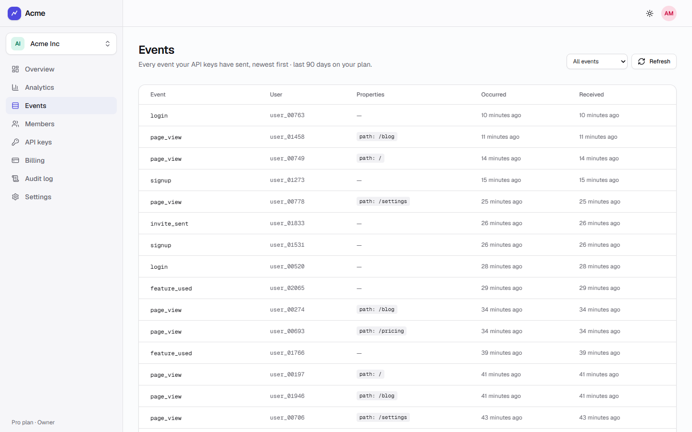<br>**Events** — every API event, filterable, with in-place refresh | 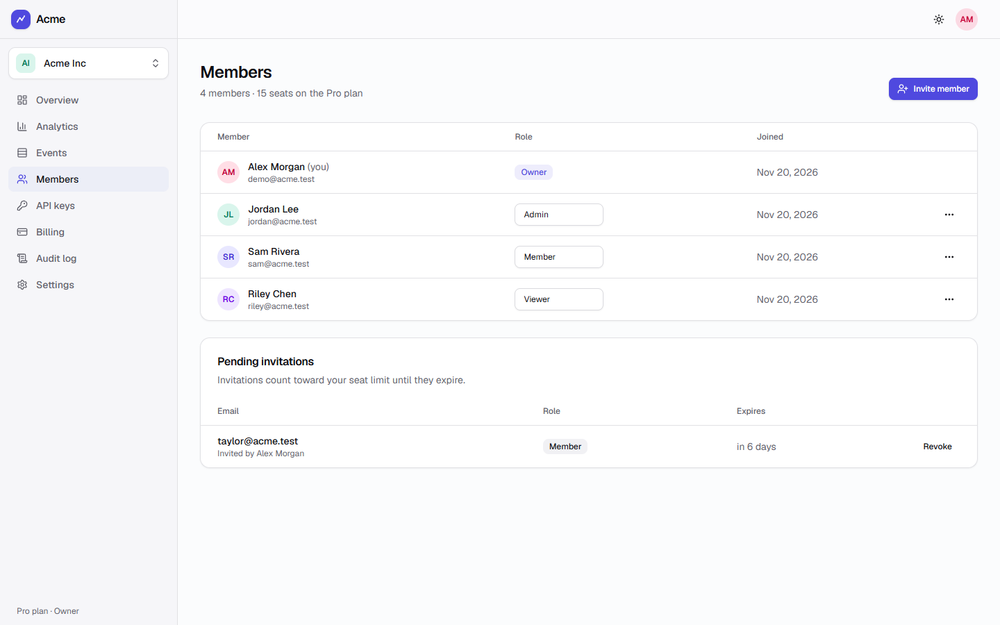<br>**Members** — roles, invitations, seat limits |
| 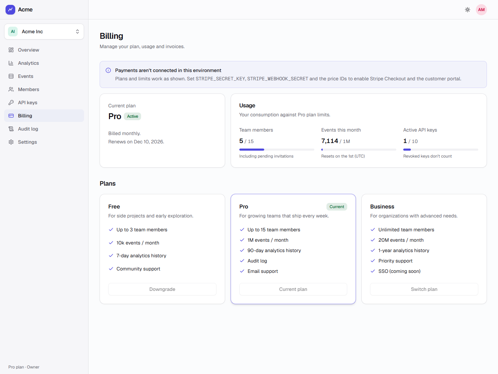<br>**Billing** — plan, usage meters, Stripe Checkout | 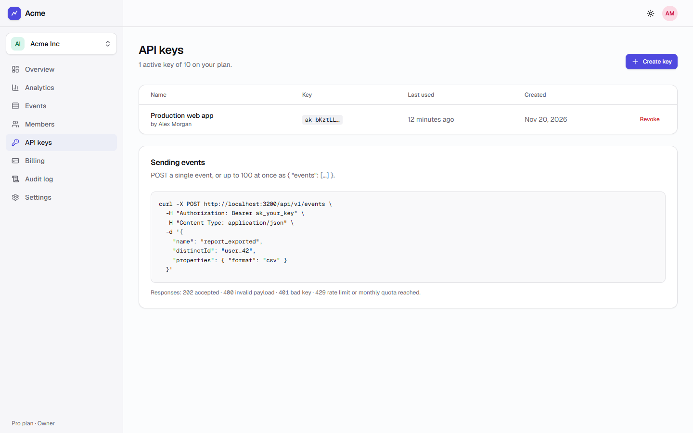<br>**API keys** — hashed, shown once, revocable |
| 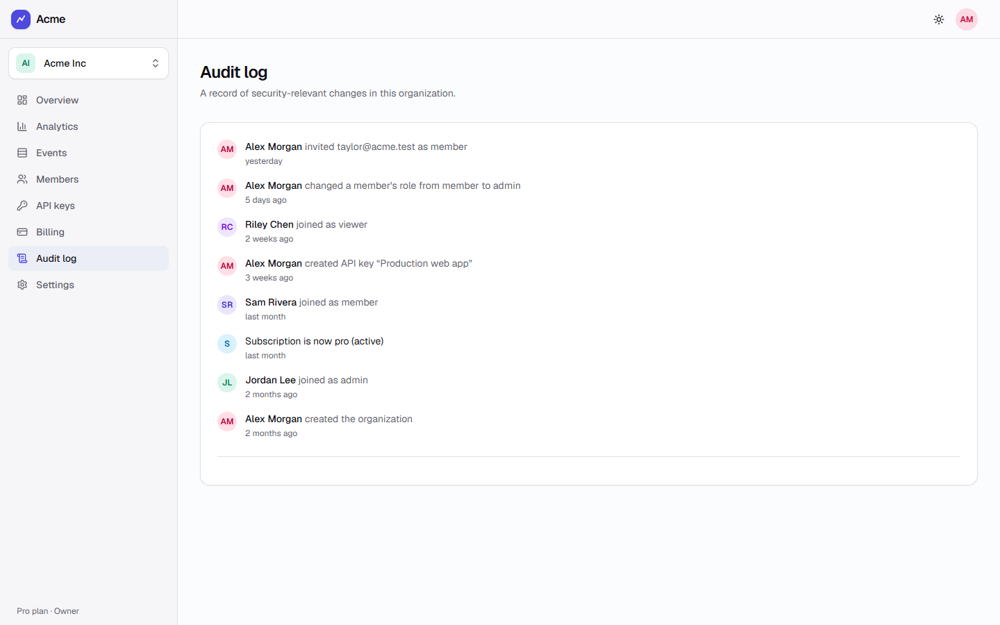<br>**Audit log** — who changed what, when (Pro+) | 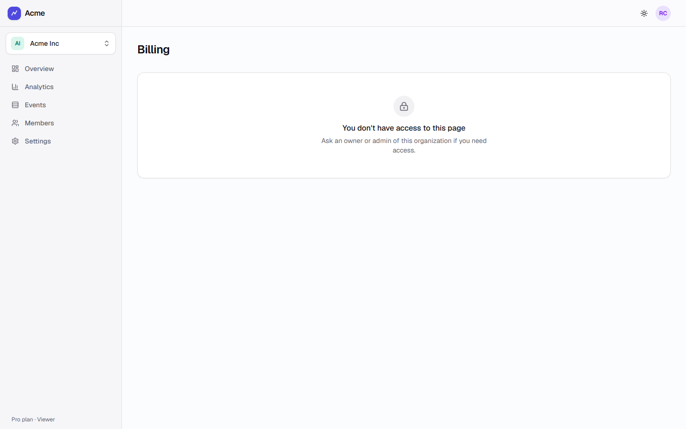<br>**RBAC** — a Viewer opening Billing by URL |

<p align="center">
  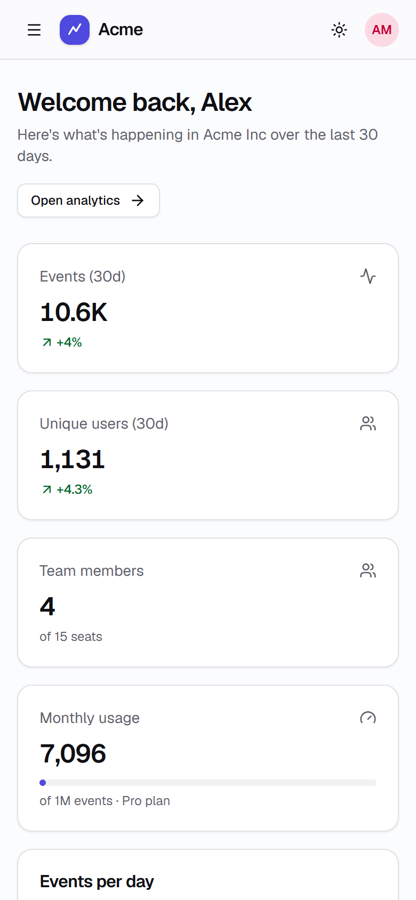
  &nbsp;&nbsp;
  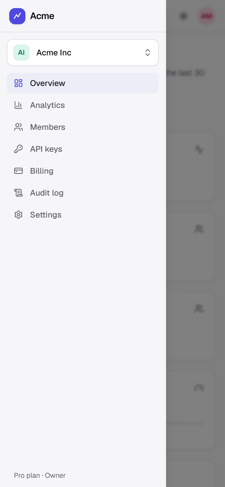
</p>

## Architecture

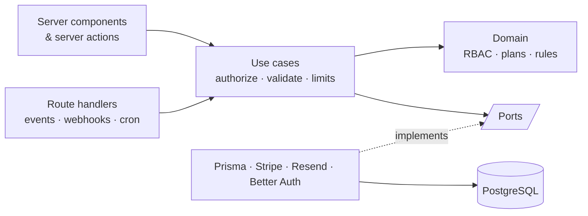

| Layer | Path | Depends on |
| --- | --- | --- |
| Domain | [src/domain](src/domain) | nothing (pure TypeScript + Zod) |
| Application | [src/application](src/application) | domain, its own port interfaces |
| Infrastructure | [src/infrastructure](src/infrastructure) | domain, application ports, vendors |
| Presentation | [src/app](src/app), [src/features](src/features), [src/components](src/components) | everything |

Request flows, the data model and sequence diagrams for ingestion and billing are in **[docs/ARCHITECTURE.md](docs/ARCHITECTURE.md)**.

## Security and authorization

| Concern | How it's handled |
| --- | --- |
| Authentication | Better Auth: scrypt passwords, OAuth, DB-validated sessions (revocation is immediate), rate limits, origin checks |
| Authorization | Central matrix (`src/domain/rbac.ts`), enforced in every use case; UI only hides what you can't use |
| Privilege escalation | Grant ≤ own role; admins can't manage admins/owners; no self-promotion; last owner protected |
| Tenant isolation | Org resolved with membership; 404 for outsiders; foreign IDs = not found; events scoped by API key |
| Secrets | API keys and invite tokens stored as SHA-256, shown once; env validated at boot |
| Payments | Signature-verified, idempotent webhooks; state re-fetched from Stripe |
| Public demo | Read-only enforced in use cases; demo accounts frozen at the auth layer; nightly reset |

Threat model, controls and the test that proves each one: **[docs/SECURITY.md](docs/SECURITY.md)**.

## Testing

| Suite | Count | What it covers |
| --- | --: | --- |
| Unit | 118 | Domain rules, use cases with in-memory fakes, the full role × operation authorization matrix, tenant isolation, demo read-only mode, Stripe adapter with real signatures |
| Integration | 22 | Real Postgres: constraints, transaction rollback, cascades, UTC analytics SQL, audit pagination, HTTP route handlers end to end |
| End-to-end | 7 (+2) | Playwright: sign-up → org → API key → ingest → dashboard → event explorer with in-place refresh; RBAC per role in the UI; mobile navigation; demo-mode smoke test |

```bash
npm test                 # unit + integration (integration needs TEST_DATABASE_URL, otherwise skipped)
```

```bash
npm run test:e2e         # needs the dev server's database seeded: npm run db:seed
```

## Technical decisions

Thirteen short decision records — why Next.js server actions, why own RBAC on top of Better Auth, why DB sessions, why 404 for non-members, raw SQL for analytics, usage counters, SHA-256 for keys, webhook design, testing strategy, demo mode, hosting — with the trade-offs of each: **[docs/DECISIONS.md](docs/DECISIONS.md)**.

## Tech stack

**App** Next.js 16 (App Router, RSC, server actions) · React 19 · TypeScript (strict) · Tailwind CSS 4 · Radix UI · Recharts
**Data** PostgreSQL · Prisma 7 (driver adapters) · Zod 4
**Services** Better Auth · Stripe · Resend
**Quality** Vitest · Playwright · ESLint with layer-boundary rules
**Ops** Vercel + Neon · Vercel Cron · Docker (standalone output)

## Run it locally

**Prerequisites:** Node.js ≥ 20.19 and PostgreSQL (Docker, a hosted database, or Prisma's local dev server).

```bash
npm install
```

```bash
cp .env.example .env
```

Set `BETTER_AUTH_SECRET` (e.g. `openssl rand -base64 32`) and `DATABASE_URL`. For a database, pick one:

```bash
docker compose up -d
```

```bash
npx prisma dev
```

`docker compose` starts Postgres 17 on `localhost:5432`, matching `.env.example`. `npx prisma dev` needs no Docker: copy the TCP URL it prints into `DATABASE_URL` and set `DATABASE_POOL_MAX=1` (its local Postgres handles one connection at a time).

Then migrate, seed and run:

```bash
npm run db:deploy
```

```bash
npm run db:seed
```

```bash
npm run dev
```

Open http://localhost:3000 and sign in with any account from the [Try it](#try-it) table. Without `RESEND_API_KEY`, emails (invitations, password resets) are printed to the server console. The seed creates publicly known demo accounts: run it only locally or on a demo deployment.

## Deploy (Vercel + Neon)

1. Import the repository in Vercel.
2. Add Postgres: **Storage → Create → Neon**. This sets `DATABASE_URL` (pooled) and `DATABASE_URL_UNPOOLED` (used for migrations).
3. Add environment variables: `BETTER_AUTH_SECRET`, and for a public demo `DEMO_MODE=true` and `CRON_SECRET`. `APP_URL` defaults to the production domain.
4. Deploy. The build runs `prisma migrate deploy && next build` ([vercel.json](vercel.json)).
5. Seed once from your machine with the Neon URL (`DATABASE_URL=… npm run db:seed`); afterwards Vercel Cron rebuilds the demo nightly.

Optional: Stripe (`STRIPE_*`, webhook to `/api/webhooks/stripe` for `checkout.session.completed` and `customer.subscription.*`), Resend (`RESEND_API_KEY`, `EMAIL_FROM`), GitHub/Google OAuth. A Dockerfile is included for self-hosting.

<details>
<summary><strong>Plans, events API, scripts and production checklist</strong></summary>

### Plans

Defined in [src/domain/plans.ts](src/domain/plans.ts) — features shown in the UI, limits enforced in use cases. The UI shows packages only; prices are set in Stripe.

| | Free | Pro | Business |
| --- | --- | --- | --- |
| Seats (members + pending invites) | 3 | 15 | Unlimited |
| Events / month | 10k | 1M | 20M |
| Active API keys | 2 | 10 | Unlimited |
| Analytics history | 7 days | 90 days | 12 months |
| Audit log | | ✓ | ✓ |
| Trial | | 14 days | 14 days |

### Events API

Create a key under **API keys**, then:

```bash
curl -X POST http://localhost:3000/api/v1/events -H "Authorization: Bearer ak_..." -H "Content-Type: application/json" -d '{"name":"signup","distinctId":"user_42","properties":{"plan":"pro"}}'
```

Send one event or `{"events": [...]}` with up to 100. Responses: `202` accepted, `400` invalid payload, `401` bad key, `413` body over 256 KB, `429` rate limit (600 req/min per key) or monthly quota reached.

### Stripe locally

Create **Pro** and **Business** products with monthly and yearly prices, put the four price IDs in `STRIPE_PRICE_*`, enable the Customer Portal, then forward webhooks:

```bash
stripe listen --forward-to localhost:3000/api/webhooks/stripe
```

### Scripts

| Command | Purpose |
| --- | --- |
| `npm run dev` / `build` / `start` | Develop, build, serve |
| `npm run check` | Lint + typecheck + tests |
| `npm test` / `npm run test:e2e` | Vitest / Playwright |
| `npm run db:migrate` | Create & apply a migration in development |
| `npm run db:deploy` | Apply migrations (production) |
| `npm run db:seed` | Load demo data |
| `npm run db:studio` | Browse data in Prisma Studio |

Screenshots are reproducible: build, start on port 3200, then `CAPTURE_SCREENSHOTS=1 E2E_BASE_URL=http://localhost:3200 npx playwright test screenshots --project=desktop`.

### Production checklist

- Set a strong `BETTER_AUTH_SECRET`; set `APP_URL` if you use a custom domain.
- Configure `RESEND_API_KEY` + `EMAIL_FROM` with a verified domain, then `REQUIRE_EMAIL_VERIFICATION=true`.
- On several instances, move the in-memory rate limiters to Redis or the database.
- Event quotas are soft under heavy concurrency; use an atomic conditional increment for hard caps.

</details>
