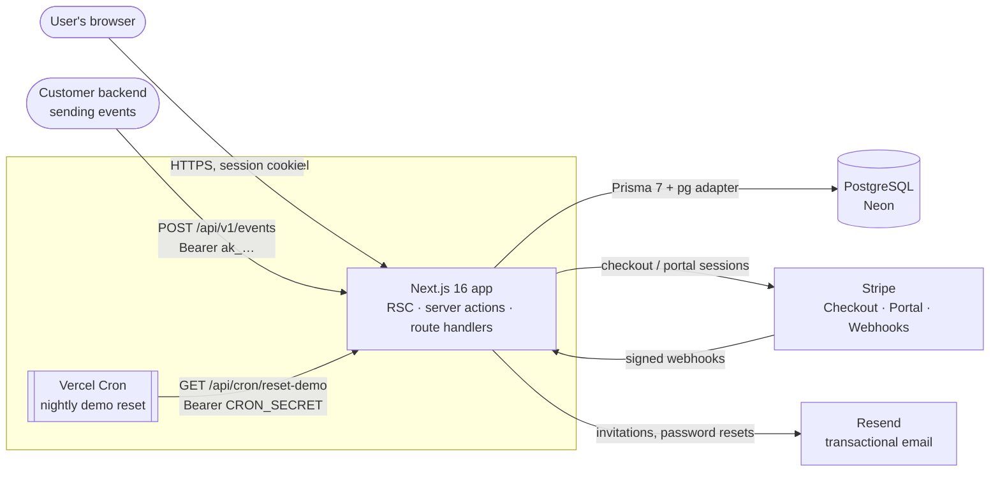
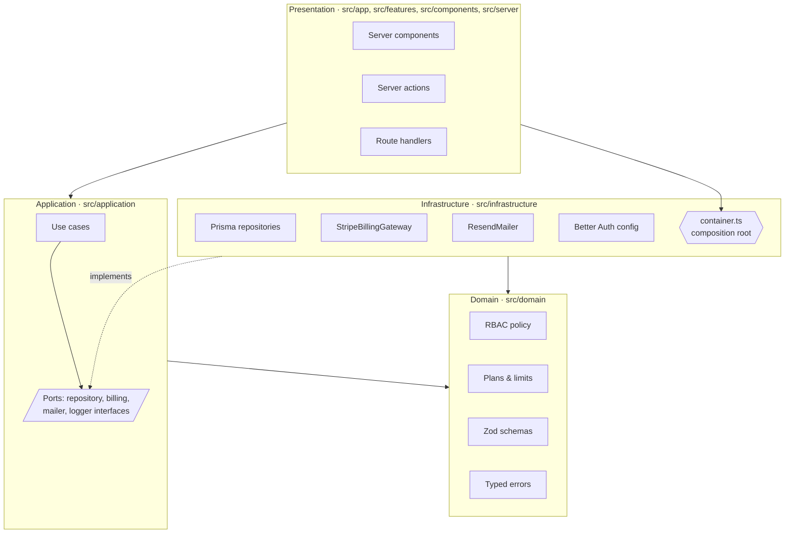
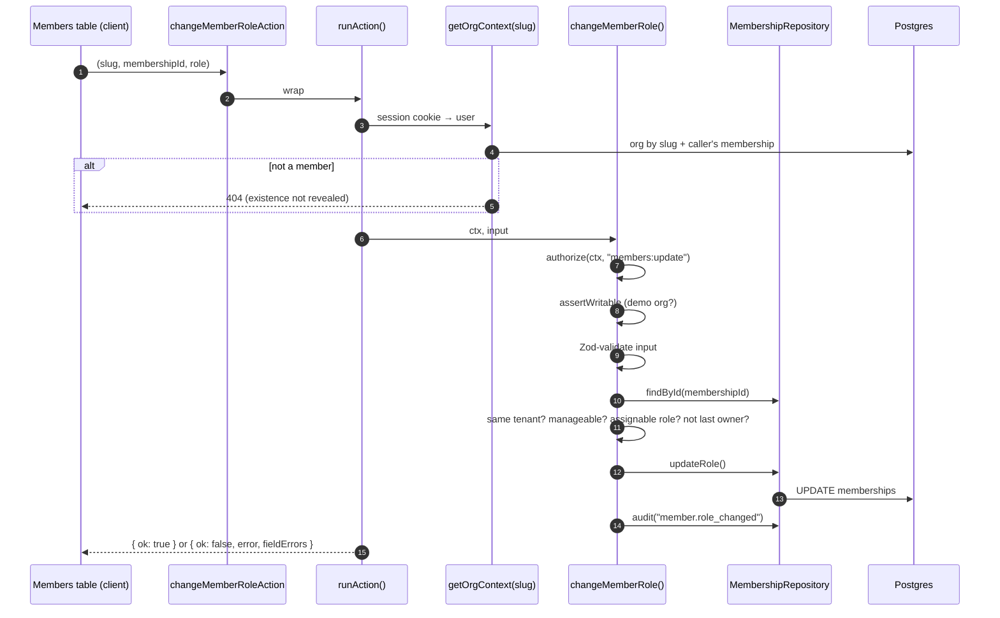
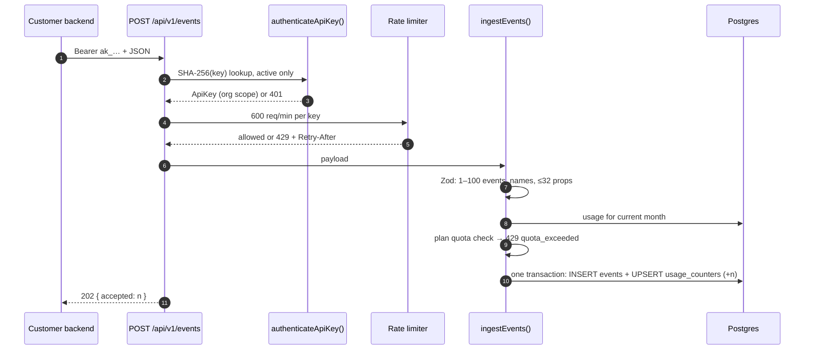
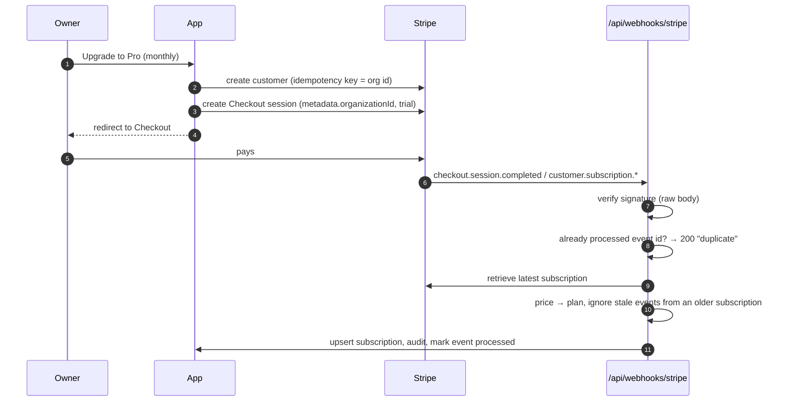
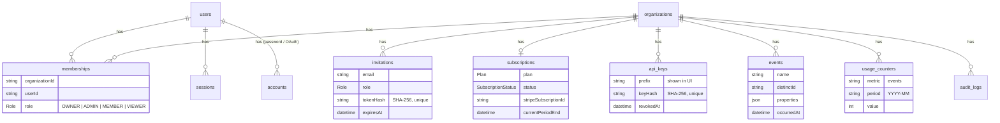

# Architecture

This document explains how the system is put together and how a request moves through it. For *why* it's built this way, see [DECISIONS.md](DECISIONS.md); for the security model, see [SECURITY.md](SECURITY.md).

## System context

One deployable unit. Every external service is behind a port, so each is optional at runtime: without Stripe the app runs on the Free plan, and without Resend emails go to the server log.

## Layers and the dependency rule

Arrows point at what a layer is allowed to import. The inner two layers never import Next.js, React, Prisma, Stripe or Better Auth — [eslint.config.mjs](../eslint.config.mjs) fails the lint step if they do.

| Layer | Knows about | Example |
| --- | --- | --- |
| Domain | Nothing but TypeScript and Zod | `canManageMember("ADMIN", "OWNER") === false` |
| Application | Domain + its own port interfaces | `inviteMember(deps, ctx, input)` authorizes, validates, checks seat limits, emails |
| Infrastructure | Everything above + vendors | `PrismaInvitationRepository.accept()` runs a transaction |
| Presentation | Everything | `inviteMemberAction` resolves the session and org, calls the use case, revalidates |

Use cases declare exactly what they need — `deps: Pick<Dependencies, "memberships" | "invitations" | …>` — so tests pass in-memory fakes and the signature documents the side effects.

## Anatomy of a mutation

Every write from the UI goes through the same pipeline. Example: an admin changes a member's role.

`runAction` turns domain errors (`ForbiddenError`, `PlanLimitError`, `ValidationError`, …) into typed results the UI can show, and masks anything unexpected as a generic message while logging the details.

Reads take the same path without the action wrapper: server components call `getOrgContext(slug)` (memoized per request with React `cache`) and then a query use case.

## Event ingestion

The organization comes from the key, never from the payload, so a key can only ever write to its own tenant.

## Billing sync

Entitlements are derived, not stored: `effectivePlan(subscription)` returns the paid plan while the status is `ACTIVE`, `TRIALING` or `PAST_DUE`, and `FREE` otherwise.

## Data model

Every tenant-owned row carries `organizationId` with `ON DELETE CASCADE`, and the hot paths are indexed (`events(organizationId, occurredAt)`, `events(organizationId, name, occurredAt)`, `audit_logs(organizationId, createdAt)`). Users are global: one account can belong to many organizations with a different role in each. `billing_events` stores processed Stripe event IDs for idempotency.

## Source map

| Path | Contents |
| --- | --- |
| [src/domain](../src/domain) | `rbac.ts`, `plans.ts`, `billing.ts`, `analytics.ts`, `validation.ts`, `errors.ts`, `entities.ts` |
| [src/application](../src/application) | `ports.ts`, `context.ts` (authorize, read-only guard, org resolution), `use-cases/*` |
| [src/infrastructure](../src/infrastructure) | `repositories/*`, `billing/stripe-gateway.ts`, `auth.ts`, `mail.ts`, `rate-limit.ts`, `container.ts`, `demo-data.ts` |
| [src/server](../src/server) | Request-scoped session/org context and the action runner |
| [src/features](../src/features) | Feature UI and server actions |
| [src/app](../src/app) | Routes, layouts, API route handlers |
| [tests](../tests), [e2e](../e2e) | Unit, integration and end-to-end tests |
